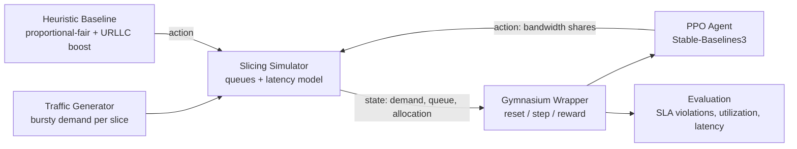

# AI-Native Resource Allocation for Dynamic Network Slicing in 6G
 


 
## Purpose
 
A 6G network splits one physical radio resource pool into virtual **slices**: eMBB (high throughput), URLLC (very low latency) and mMTC (massive IoT). Static splits waste capacity when one slice is idle and another is starved. This project trains a **PPO reinforcement-learning agent** to reallocate bandwidth across the three slices every step, and benchmarks it against a proportional-fair heuristic on **SLA violations** and **bandwidth utilization**.
 

## Architecture

 
**Research workflow (pseudo code)**
 
```text
FOR each experiment IN [reward_shaping, ppo_hyperparams, traffic_generalization, action_cap]:
    env      <- NetworkSlicingEnv(config = experiment.config, seed = s)
    agent    <- PPO(policy = MLP, env, lr, n_steps, clip_range)
    FOR step = 1 .. total_timesteps:
        state  <- [demand_i, queue_i, alloc_i  for i in slices]
        action <- agent.policy(state)                 # raw shares
        alloc  <- normalize(action) * total_bandwidth
        served <- min(demand, alloc);  queue <- max(queue + demand - served - drain, 0)
        latency <- f(queue);  violation <- max(latency - SLA, 0)
        reward <- -w1 * sum(violation) + w2 * sum(served) / total_bandwidth
        agent.update(clipped PPO objective)
    FOR policy IN [agent, heuristic]:
        log mean SLA violations, utilization, latency over N unseen episodes
    compare(agent, heuristic); save table + plots to docs/
```
 
## Setup
 
```bash
git clone https://github.com/Shriraamakrishanan/Native-Resource-Allocation-Dynamic-6G.git
cd Native-Resource-Allocation-Dynamic-6G
python -m venv .venv
```

Activate the virtual environment, then install the project dependencies:

```bash
# macOS / Linux
source .venv/bin/activate

# Windows PowerShell
.\.venv\Scripts\Activate.ps1

python -m pip install -r requirements.txt
```
 
## Usage
 
```bash
python demo_6g_slicing.py
```
 
The demo trains a PPO agent and saves its visualization as
`6g_slicing_demo_results.png`. The checked-in `docs/reward_curve.png` and
`logs/sample.monitor.csv` are sample artifacts; the monitor data is synthetic,
not a record of an actual training run.

The `ns-3-dev` and `ns3-mmwave` directories are Git submodules for the upstream
simulation projects. Initialize them after cloning with:

```bash
git submodule update --init --recursive
```
 
## Results
 
Mean over [20] evaluation episodes of 200 steps, seed [__]. Replace the placeholders with the output of `evaluate.py`.
 
| Method | SLA violations / episode | Utilization | Mean URLLC latency (ms) |
|---|---|---|---|
| PPO agent | [x.xx] | [xx%] | [x.xx] |
| Proportional-fair heuristic | [x.xx] | [xx%] | [x.xx] |
 


## Reflection
 
The biggest hurdle was getting PPO to learn anything beyond an equal split. Early training showed a flat reward curve. Logging each reward component separately showed the SLA-violation penalty, which grows into the hundreds during bursts, swamped the utilization reward capped at 5, so the agent had no useful gradient. I normalized both terms to comparable magnitudes, added queue length and current allocation to the observation so the agent could see the effect of its last action, and seeded the environment's random generator so runs were repeatable. After this, the agent began shifting bandwidth toward URLLC during bursts and violations fell from [X] to [Y] per episode against the heuristic. The lesson: in reinforcement learning, debugging the reward signal matters more than tuning the algorithm. *(Edit this to match what actually happened in your runs.)*
 
## Release
 
```bash
git add -A && git commit -m "Complete mock-environment PPO pipeline with benchmark"
git tag -a v1.0 -m "v1.0: PPO vs heuristic network slicing benchmark (mock environment)"
git push origin main && git push origin v1.0
```
 
**Roadmap:** ns-3 + 5G-LENA integration via ns3-ai / ns3-gym for realistic PHY/MAC behavior.
 
